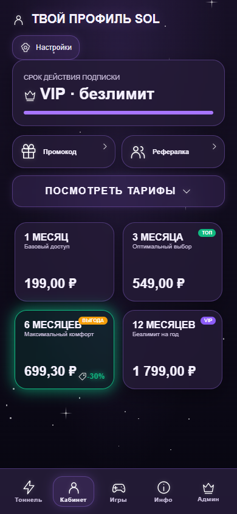
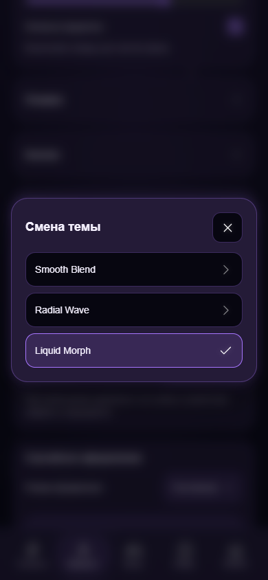
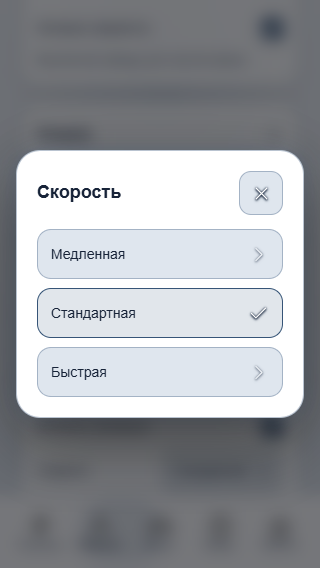
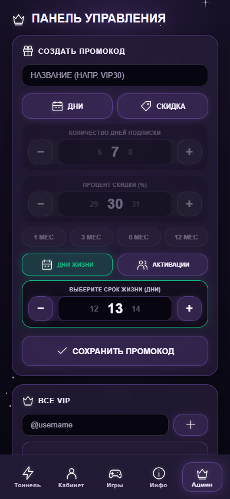

# Mini App: единые SVG и диалоги настроек

Frontend-обновление от `main` после PR #9 (`4b72b3a`). Декоративные эмодзи
в навигации, профиле, тарифах, играх, админке и уведомлениях заменены
тонколинейными SVG со свечением в стиле FAQ. Значимые `⭐` и `₽`, тексты FAQ,
пользовательские имена, сообщения и названия сохранённых оформлений сохраняются.
Золотое состояние действующего VIP сохранено.

## Поведение

- Один локальный реестр SVG, общий для статических слотов и динамического UI.
  Сообщения интерфейса создаются текстовыми узлами; HTML от сервера не исполняется.
- Стрелки разделов морфятся изменением координат пути за 320 мс, без rotation.
  Раскрытие настроек использует высоту, opacity и translate за 360 мс;
  быстрые повторы отменяют старую анимацию. Тарифы больше не зависят от
  отложенных callbacks, которые могли скрыть повторно открытый раздел.
- Все шесть списков настроек (Classic, плашки, кнопки, скорость, переход,
  случайный режим) открывают общий диалог с blur/dim фоном. Он поднимается
  от `33vh` ниже центра за 440 мс. Выбор применяется сразу, отмена сохраняет
  прежнее значение. Фон блокируется, фокус возвращается на кнопку.
  Поддержаны Tab/Shift+Tab, стрелки, Home/End, Enter/Space, Escape,
  Telegram BackButton и закрытие нажатием на фон.
- Smooth Blend / Radial Wave / Liquid Morph сохраняются. Длительности:
  740 / 560 / 380 мс для slow / normal / fast. Добавлена небольшая глубина
  через perspective/translateZ и масштаб; полноэкранный анимированный blur
  убран. Диалог закрывается до снимка смены палитры.
- Для слабых устройств отключены snapshots, 3D и blur диалога. Есть CSS
  fallback смены палитры, fallback без WAAPI и reduced motion, в том числе
  при смене системного параметра во время раскрытия. У новых эффектов нет
  постоянных `will-change` слоёв и непрерывных анимационных циклов.

Сохранены шесть тем, Classic Light/Dark, пресеты и изоляция по пользователю,
VIP, RUB/Stars quotes, Telegram Stars checkout и все прежние функции.
Backend, production-БД, FirstVDS, права Telegram ID 488212820 и содержимое
`config.js` не изменены. ЮKassa не включалась; реальные платежи и сообщения
не выполнялись. Merge и deploy не выполнялись.

## Проверки

Пройдены **132 offline-сценария** в headless Chrome с подменённым Telegram SDK
и локальными API, с блокировкой внешнего трафика:

| Suite | Проверки |
| --- | ---: |
| appearance | 16 |
| payment-cleanup | 10 |
| payment-methods | 22 |
| stars-checkout | 12 |
| payment-expiry | 12 |
| admin-users | 19 |
| info-faq | 20 |
| miniapp-ui | 21 |

Прежние тесты сохранены: выбор через native select заменён взаимодействием
с диалогом, а ожидание толщины SVG приведено к общему FAQ-стилю 1.4.
Тестовые HTTP-серверы также отдают два новых UI-файла.

`node --check` для трёх runtime JS и `git diff --check` проходят.
Ошибок JavaScript в браузере нет. Проверены ширины 320/360/390/440/1024 px,
высота 330 px при экранной клавиатуре, тёмная и светлая палитры,
фокус и возврат фокуса, повторные открытия и отмены, reduced motion,
упрощённые эффекты и отсутствие финансовых POST из новых настроек.

Визуально просмотрены профиль во всех шести темах, навигация, админка,
тоннель, игры, FAQ, диалоги 390 px и Classic Light 320 px, а также
промежуточные кадры трёх переходов и подъёма диалога.
Снимки используют искусственные offline-данные и системный fallback шрифта.
Физические Android/iOS и реальные Telegram WebView в этой среде не проверялись.

## Снимки для ревью

Профиль, 390 px:

Диалог переходов, 390 px:

Classic Light, 320 px:

Админка, 390 px:

Полный набор снимков можно воспроизвести через `SOL_UI_SCREENSHOT_DIR`;
команды и зависимости описаны в `tests/README.md`.
При будущем frontend-релизе нужны также `miniapp-ui.js` и `miniapp-ui.css`;
версии ассетов в HTML обновлены до 5009, URL `config.js` сохранён.
